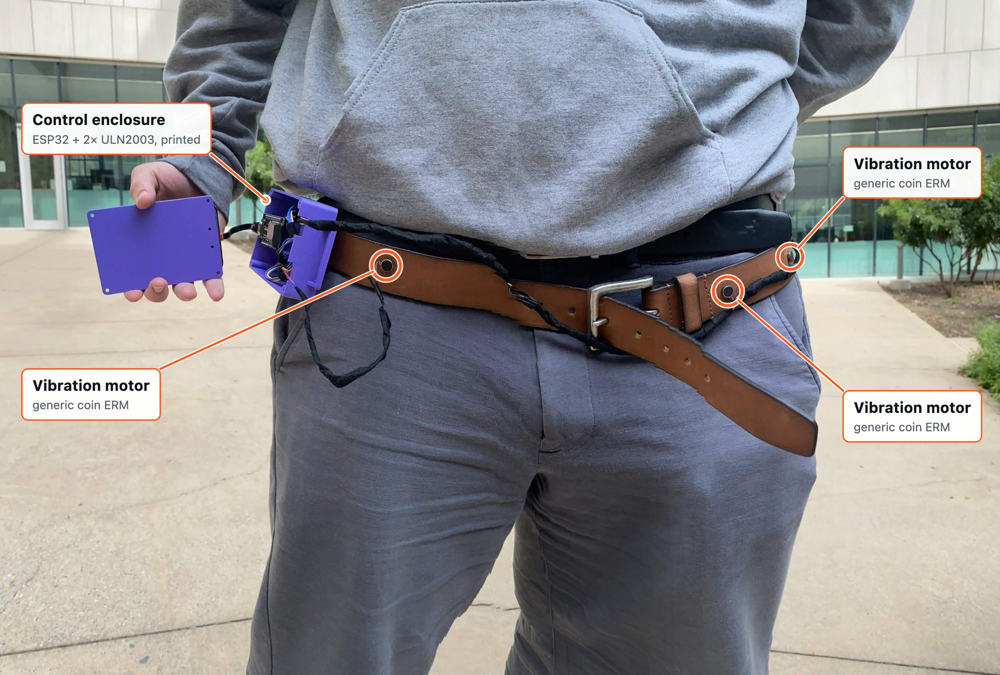
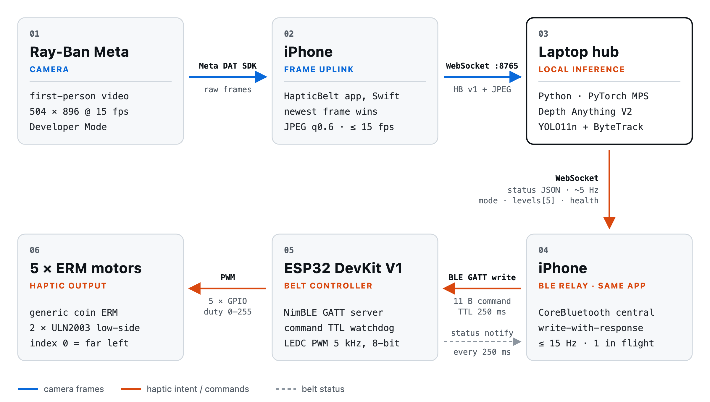
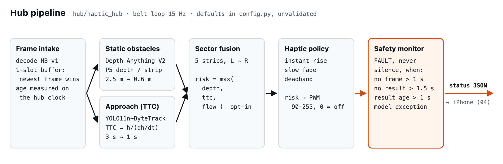
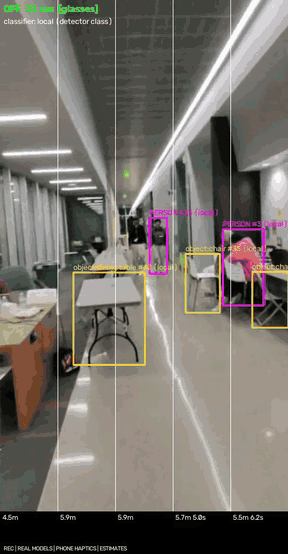
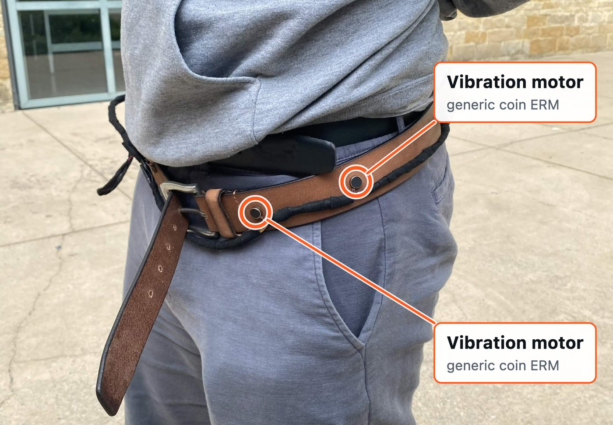
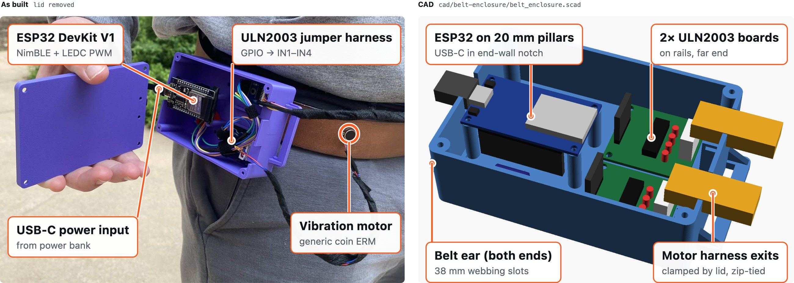
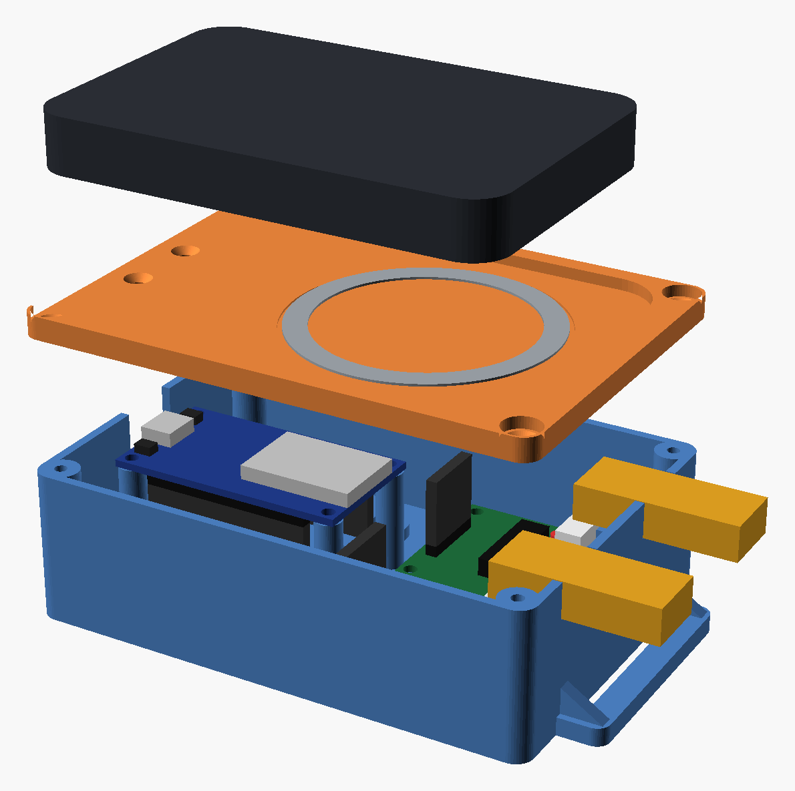
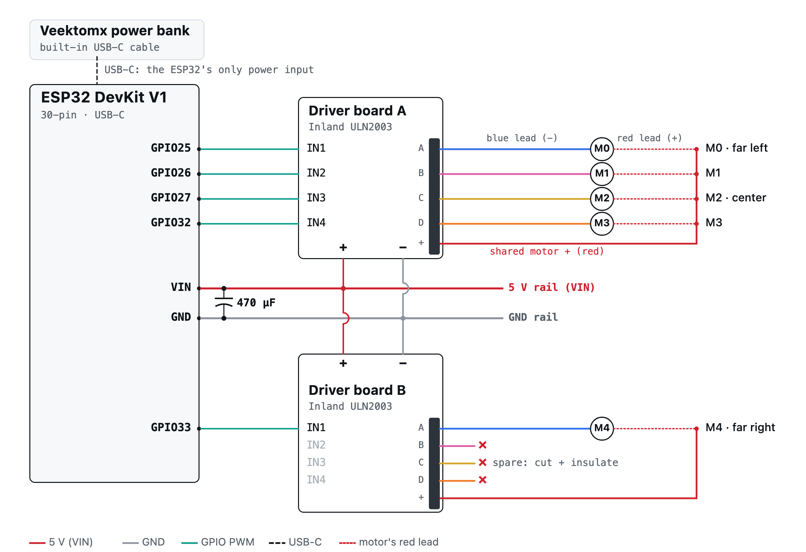

<div align="center">

# Haptic Belt

**First-person video in, directional vibration out.**
A wearable collision-alert prototype for blind and low-vision users, built at HackUTD 2026.

[](https://github.com/chxrro/hackutd-26/actions/workflows/ci.yml)


[Overview](#overview) · [Architecture](#system-architecture) · [Demo](#perception-demo) · [Hardware](#hardware) · [Protocol](#wire-protocol) · [Getting started](#getting-started) · [Results](#measured-results) · [Limitations](#limitations-and-safety)



</div>

> [!WARNING]
> This is an experimental hackathon prototype. It is **not** a mobility aid and must not replace a cane, guide dog or orientation-and-mobility training. Distance, time-to-collision and detection accuracy are unvalidated. Only use it seated, standing, or in a supervised bench setting.

## Overview

A pair of Ray-Ban Meta glasses streams the wearer's point of view to an iPhone. The phone forwards frames to a laptop on the same network, where a monocular metric-depth model and a tracked object detector estimate collision risk in five directions. The resulting per-direction intensities travel back to the phone, which relays them over Bluetooth LE to an ESP32 on the belt. The ESP32 drives five coin vibration motors arranged around the waist from the wearer's far left to far right.

Design rules that shaped the system:

- **A vibration means "obstacle in that direction"**, never "move that way". Obstacle direction and suggested travel direction are kept separate.
- **Silence is never presented as a clear path.** Stale frames, a stalled model, a dropped phone or a lost BLE link all produce an explicit fault pattern on the belt instead of quiet.
- **Every command expires.** The belt stops a command after its TTL (250 ms) unless a fresh one arrives, so a crashed laptop or phone cannot leave a motor running.
- **Inference stays local.** Both perception models run on the laptop (Apple MPS or CUDA). No frames leave the local network in the default configuration.

## System architecture

<p align="center">
  
</p>

The iPhone appears twice because it plays two roles in one app: it uplinks camera frames to the hub, and it is the BLE central that relays the hub's motor levels to the belt. The laptop can also own the BLE link directly (`haptic-hub run --belt ble`); exactly one central may be connected at a time.

| Hop | Transport | Payload | Rate / bound |
|---|---|---|---|
| Glasses → iPhone | Meta Wearables Device Access Toolkit 1.0.1 | raw frames, 504 × 896 | 15 fps requested |
| iPhone → hub | WebSocket, `ws://<laptop>:8765/` | `HB` v1 binary: 20-byte header + JPEG (q 0.6) | ≤ 15 fps, newest frame wins, never queued |
| Hub → iPhone | same WebSocket, text | status JSON: `mode`, `levels[5]`, `healthy`, `reason`, `hazards` | ~5 Hz |
| iPhone → ESP32 | BLE GATT write-with-response | 11-byte v1 command | ≤ 15 Hz, one write in flight, TTL 250 ms |
| ESP32 → iPhone | BLE notify | 20-byte status: applied `seq`, mode, levels, build id | every 250 ms and on every mode change |
| ESP32 → motors | LEDC PWM on GPIO 25, 26, 27, 32, 33 | 8-bit duty per motor via ULN2003 | 5 kHz |

### Perception pipeline

All of this lives in [`hub/haptic_hub`](hub/README.md). Every threshold below is a default in `config.py` and has **not** been validated against measured distances.

<p align="center">
  
</p>

1. **Static obstacles.** [Depth Anything V2](https://github.com/DepthAnything/Depth-Anything-V2) *Metric Indoor Small* (outdoor variant via `--outdoor`) predicts metres per pixel. The frame is split into five vertical strips; each strip takes the 5th-percentile depth in the middle band of the image (the bottom band is floor). Risk ramps linearly from 0 at 2.5 m to 1 at 0.6 m.
2. **Approaching objects.** [YOLO11n](https://docs.ultralytics.com/models/yolo11/) with ByteTrack assigns a persistent ID to each object. Time-to-collision is estimated from box growth, TTC ≈ h / (dh/dt), fitted over 0.6 s. Risk ramps from 0 at 3 s to 1 at 1 s, applied to every strip the box covers.
3. **Fusion.** `risk[sector] = max(depth_risk, ttc_risk[, flow_risk])`. Optional Lucas–Kanade optical flow (`--motion flow`) can only raise risk.
4. **Haptic policy.** Rising risk applies immediately, falling risk decays, a deadband suppresses noise, and the result maps to PWM 90–255 (0 = off).
5. **Safety monitor.** No frame for 1 s, no result for 1.5 s, a result computed from a frame older than 1 s, or a model exception switches the belt to the fault pattern.

Opt-in alternatives: `--detector openvocab` swaps YOLO11n for text-prompted [YOLOE](https://docs.ultralytics.com/models/yoloe/) (poles, bollards, stairs, curbs), and `--alert-profile stable` requires three frames over 200 ms before a moderate alert fires. See the [hub README](hub/README.md) for timings and trade-offs.

## Perception demo

<table>
<tr>
<td width="300" valign="top">

</td>
<td valign="top">

Hub renderer output while streaming live from the glasses (10 s excerpt, 8 fps GIF). **[Full 60 s recording (MP4)](docs/media/yolo-demo.mp4).**

Real models on real glasses frames: Depth Anything V2 Metric Indoor Small and YOLO11n + ByteTrack on Apple MPS. Phone haptics were enabled; **no physical belt was connected**, so motor output is the hub's computed levels.

| Overlay | Meaning |
|---|---|
| `LEVELS 31 ms [glasses]` | belt mode, inference time, declared frame source |
| magenta box | `PERSON #id` (ByteTrack ID) |
| orange box | `object:<COCO class> #id` |
| white columns | the five sector boundaries |
| `5.1m 2.6s` | per-sector depth and TTC **estimates** |
| red bars | per-motor level sent toward the belt |
| `9.8fps drop 7 … tot 82 ms` | hub input rate and per-stage latency |

Detections and distances are model outputs, not ground truth.

</td>
</tr>
</table>

## Hardware

<p align="center">
  
  <br><sub>Left side of the belt, continuing from the front view at the top of the page. The motor harness runs in a sleeve along the belt to the enclosure on the right hip.</sub>
</p>

### Bill of materials

| Qty | Part | Role |
|---:|---|---|
| 1 | Ray-Ban Meta (Gen 2) glasses | first-person camera, Developer Mode enabled in Meta AI |
| 1 | iPhone (tested: iPhone 17, iOS 27.2) | frame uplink and BLE relay |
| 1 | Apple-silicon laptop (tested: MacBook, MPS) | local inference hub |
| 1 | ESP32 DevKit V1, 30-pin, USB-C | BLE GATT server, PWM, TTL watchdog |
| 2 | Inland ULN2003 driver boards | low-side switching, one channel per motor |
| 5 | Generic coin ERM vibration motors | haptic output, index 0 = far left |
| 1 | 470 µF electrolytic capacitor | bulk decoupling across the 5 V rail |
| 1 | Veektomx MagSafe power bank, built-in USB-C | sole power input via the ESP32's USB-C |
| 2 | 5-wire JST-XH stepper cables + ribbon extension | motor harness, cut and spliced |
| 1 | 3D-printed enclosure (base, lid, clip) | [`cad/belt-enclosure`](cad/belt-enclosure/README.md) |
| 1 | Leather belt | motor carrier |

### Control enclosure: as built vs. CAD

<p align="center">
  
</p>

The enclosure is a parametric [OpenSCAD model](cad/belt-enclosure/belt_enclosure.scad) with every dimension exposed as a named parameter. `./build.sh` exports print-ready STL/3MF files (base, lid and clip on one 233 × 168 mm plate, no supports), renders previews, and runs interference checks that fail the build if any two parts overlap by ≥ 0.02 mm.

<table>
<tr>
<td width="38%"></td>
<td valign="top">

| Property | Value |
|---|---|
| Outer size (default parameters) | 112.3 × 78 × 35.5 mm (132.3 mm with belt ears) |
| Stack-up | webbing → base → ULN2003 on 4 mm rails, ESP32 on 20 mm pillars → lid → MagSafe ring → bank |
| Openings | USB-C notch only; 2 harness U-notches clamped by the lid |
| Fasteners | 4 × M3 × 10 lid screws, 2 × M3 + captive hex nuts for the clip |
| Print | PETG preferred, 0.2 mm layers, 4 walls, 20–25 % infill |

Several dimensions were estimated from photos before parts were measured; they are marked `MEASURE` in the source.

</td>
</tr>
</table>

### Wiring

<p align="center">
  
</p>

| Motor | Position | ESP32 pin | Driver channel | Harness wire |
|---|---|---|---|---|
| M0 | far left | GPIO25 | board A, IN1 → A | blue |
| M1 | left | GPIO26 | board A, IN2 → B | pink |
| M2 | center | GPIO27 | board A, IN3 → C | yellow |
| M3 | right | GPIO32 | board A, IN4 → D | orange |
| M4 | far right | GPIO33 | board B, IN1 → A | blue |

Each ULN2003 channel sinks the motor's negative lead while every positive lead sits on the shared 5 V wire, so each motor's strength is set independently by its PWM duty (capped by `kMaxDuty` in [`esp32/include/config.h`](esp32/include/config.h)). The pins avoid ESP32 strapping pins (0, 2, 12, 15) and input-only pins (34–39). The motor order must match the firmware or alerts point the wrong way; verify it with `haptic-hub bench --only motor-map` or the app's per-motor test. The diagram's rail voltage and the motors' current draw have not been measured.

### Belt behavior

| Situation | What the wearer feels |
|---|---|
| Boot, before any central connects | self-test sweep left → right, then silent |
| Obstacle risk in one or more sectors | the matching motors vibrate, stronger as risk rises |
| No risk above threshold | `off`: silent, which is **not** a guarantee of a clear path |
| Hub cannot vouch for its output (`fault`) | double pulse on all motors every 2 s |
| No valid command within the TTL, or BLE dropped | motors stop, fault pattern for 30 s, then dormant |
| Pause / resume / session ended (laptop-owned BLE link) | outside-in cue / inside-out cue / three fading inner pulses; through the iPhone relay these hub states arrive as `fault` |

Implemented in [`esp32/lib/belt_core`](esp32/lib/belt_core/src) as plain C++ with no Arduino dependencies, so the same logic runs in the firmware, in host unit tests and inside the hub's simulator.

## Wire protocol

The three components share one contract, [`docs/protocol.md`](docs/protocol.md). All integers are little-endian, every message carries a version byte, and golden vectors are checked by tests in `hub/`, `esp32/` and `meta/`.

**Frame packet** (phone → hub, WebSocket binary)

```text
 0      2    3     4           8                16       18       20
 ┌──────┬────┬─────┬───────────┬────────────────┬────────┬────────┬──────────┐
 │ "HB" │ v1 │ flg │ seq u32   │ capture_ms u64 │ w u16  │ h u16  │ JPEG …   │
 └──────┴────┴─────┴───────────┴────────────────┴────────┴────────┴──────────┘
```

**Haptic command** (central → belt, BLE write to `71dbf1b6-…-b8a38e54618f`)

```text
 0      1      2     3            5       6
 ┌──────┬──────┬─────┬────────────┬───────┬────────────────────┐
 │ v1   │ mode │ seq │ ttl_ms u16 │ count │ levels[count] u8   │
 └──────┴──────┴─────┴────────────┴───────┴────────────────────┘
 mode: 0 off · 1 levels · 2 fault        ttl clamped to 50–1000 ms

 golden  01 01 07 fa 00 05 00 40 80 c0 ff
         levels · seq 7 · ttl 250 · [0, 64, 128, 192, 255]
```

The belt also exposes an info characteristic (`[version, motor_count]` + build id) and a status characteristic that reports the last **applied** sequence number, its age and the live motor levels. Centrals use status to distinguish "the radio accepted the write" from "the firmware is following it".

## Repository layout

| Path | Contents | Runs on |
|---|---|---|
| [`hub/`](hub/README.md) | perception, haptic policy, safety monitor, BLE/sim belt, dashboard, recorder, simulator | laptop, Python 3.11+ |
| [`esp32/`](esp32/README.md) | NimBLE GATT server, PWM motor driver, TTL/fault logic, serial bench console | ESP32 (PlatformIO, Arduino) |
| [`meta/`](meta/README.md) | HapticBelt iOS app: glasses stream, hub client, BLE belt relay, speech, phone haptics | iPhone (Swift, XcodeGen) |
| [`ios/`](docs/camera-bridge.md) | Camera Bridge, the earlier wearer-app and streaming diagnostic | iPhone |
| [`desktop/`](desktop/viewer.py) | local browser viewer for Camera Bridge | Mac |
| [`cad/`](cad/belt-enclosure/README.md) | parametric enclosure, export and interference-check script | OpenSCAD |
| [`docs/`](docs) | protocol, hardware bring-up runbook, glasses setup, navigation research, project log | — |

## Getting started

### Hub only (no hardware)

Requires [uv](https://docs.astral.sh/uv/). The first real run downloads Depth Anything V2 Small (~100 MB) and `yolo11n.pt` (~6 MB).

```bash
cd hub
uv sync --extra vision
uv run haptic-hub run --source webcam --belt sim --show          # laptop webcam, simulated belt
uv run haptic-hub run --source video:walk.mp4 --belt sim --show  # any recorded clip
uv run python -m haptic_hub.sim                                  # scripted end-to-end scenarios
```

### Full loop: glasses → iPhone → hub → iPhone → belt

```bash
# 1. Belt firmware (ESP32 on USB)
cd esp32
pio test -e native             # host-side logic tests
pio run -e esp32dev -t upload  # build and flash
pio device monitor             # 115200 baud; boots with a left-to-right self-test

# 2. Hub: real perception, phone owns the BLE link
cd hub
uv run haptic-hub run --source glasses --perception vision --belt sim --device mps --show
#   prints the address to enter in the app, e.g. ws://192.168.x.y:8765

# 3. iPhone app
cd meta
cp Config/Local.xcconfig.example Config/Local.xcconfig   # set DEVELOPMENT_TEAM once
xcodegen generate && open HapticBelt.xcodeproj           # run on a physical iPhone
```

In the app: connect the glasses through Meta AI, start the camera, enter the hub address, then under **ESP32 belt · phone Bluetooth** pick the belt, test each motor, and only then enable **Send alerts to belt**. Glasses Developer Mode, network requirements and troubleshooting are covered in [`meta/README.md`](meta/README.md) and [`docs/meta-setup.md`](docs/meta-setup.md). Hardware-day checks with pass/fail criteria are in [`docs/hardware-bringup.md`](docs/hardware-bringup.md).

### Enclosure

```bash
cd cad/belt-enclosure
./build.sh                                 # STL/3MF + renders + interference checks
./build.sh -D bank_l=98.4 -D bank_w=64.2   # override measured dimensions
```

## Measured results

Each figure is labelled with how it was obtained. *Hardware* means a real phone, glasses or belt; *replayed* means recorded or still images fed through the real pipeline; *simulation* means the real hub against a scripted world.

| Measurement | Result | Evidence |
|---|---|---|
| Glasses → hub frame rate after the phone's rate-limiter fix | 12.0–12.6 fps (four 5 s windows) | hardware, 2026-11-08 |
| Hub on live glasses frames, depth + YOLO11n, Apple MPS | 12.6 fps in, 12.4 fps perception, inference 33 ms median / 36 ms p90 | hardware, one 5 s window |
| YOLO11n `track()` alone, M4 Max | 9.2 ms median / 11.3 ms p90 | replayed stills |
| Full `vision` step (depth + YOLO11n), M4 Max | 40.4 ms median / 45.7 ms p90 (15 Hz budget: 67 ms) | replayed stills |
| iPhone → ESP32 BLE heartbeat, alerts off | 1,659 commands over ~130 s, 0 TTL expiries, max gap 180 ms, max firmware queue delay 7 ms | hardware, belt on USB |
| End-to-end scenarios (direction, approach, head motion, stale frames, disconnects, model crash, lost BLE writes) | 24 / 24 pass, each shown to fail on a deliberately broken hub | simulation, ground-truth stand-ins for the models |

CI runs `uv run pytest` for the hub and `pio test -e native` plus a compile-only `pio run -e esp32dev` for the firmware on every pull request. The iOS app is tested locally on the simulator and is not built in CI. CI does not load models or exercise a camera, BLE or the belt.

**Not yet measured:** detection, distance and TTC accuracy; capture-to-vibration latency; BLE reliability under full streaming load; how distinguishable the five motors are to a wearer.

## Limitations and safety

- **Head-mounted camera, torso-mounted belt.** Directions are relative to where the wearer is looking, not where the body is facing.
- **Coverage gaps.** Low obstacles, curbs, drop-offs, thin poles and transparent glass are largely missed by both depth and detection in our tests.
- **Box-growth TTC lags.** In simulation it reads roughly 0.35 s late, and a static wall or pole produces little box growth until it is close.
- **BLE delivery is not fully characterized.** Isolated TTL expiries (receive gaps up to 270 ms) were observed before the 15 Hz cadence change, and the firmware watchdog caught each one. The latest build has only been checked with alerts off and the glasses disconnected.
- **Privacy.** Recording is off by default (`--record` enables it). Recordings can show bystanders' faces and locations: obtain consent, keep them out of git, and delete them when done.

Development history, decisions and the evidence behind each claim are recorded in [`docs/project-context.md`](docs/project-context.md).

## Team

Built at HackUTD 2026 by [@chxrro](https://github.com/chxrro), [@NathanS11](https://github.com/NathanS11), [@wxu012](https://github.com/wxu012) and [@minjuna77](https://github.com/minjuna77).
